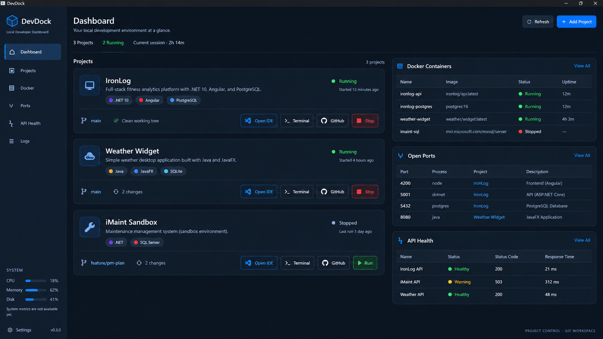

# DevDock

**Your local development environment at a glance.**

DevDock is a cross-platform desktop control center for local software development environments. Import a local project, inspect its stack, run it, read its output and work with its Git repository in one focused workspace.


## Preview



## Current status

**DevDock v0.3 — Project Control + Git Workspace**

DevDock starts with an empty workspace. Add local projects to use discovery, project execution and Git operations. Imported **LOCAL** projects remain in memory for the current application session. Docker, open-port detection, API health, system metrics and the workspace activity feed are not implemented yet; their panels show availability messages without fabricated records or measurements.

### Available now

- Native folder selection, bounded asynchronous project discovery and import confirmation.
- Technology badges, duplicate detection and clear warnings for partial discovery.
- Project details with **Overview**, **Git** and **Output** tabs.
- Run/Stop for supported local project targets, with a session-specific choice when several targets exist.
- Read-only stdout/stderr, auto-scroll, Clear, timestamps and bounded output retention.
- Real Git branch, changes, staged changes, remotes and linear commit history.
- Fetch, fast-forward-only Pull, Stage Selected, Stage All, per-file Stage/Unstage, Unstage Selected and local Commit.
- Remove from DevDock with confirmation, without deleting project files.

## Tech stack

| Layer | Technology |
| --- | --- |
| Language / runtime | C# / .NET 10 |
| Desktop UI | Avalonia UI 12.1.4 and XAML |
| Application pattern | MVVM with CommunityToolkit.Mvvm 8.4.2 |
| Discovery | Bounded local manifest inspection |
| Git | Locally installed Git CLI |
| Execution | Tracked native processes with redirected output |
| State | In-memory session data; no database |

Windows and macOS are the target platforms. Windows has been used for development and runtime verification. macOS execution and packaging remain unverified.

## Getting started

Install the **.NET 10 SDK**. Git functionality also requires **Git on PATH**. Running imported projects requires their normal SDK/runtime, installed dependencies and local configuration.

```sh
git clone https://github.com/xanthosgeorge/DevDock.git
cd DevDock
dotnet restore DevDock.sln
dotnet build DevDock.sln
dotnet run --project src/DevDock.Desktop/DevDock.Desktop.csproj
```

The dashboard starts at **1400 × 900** and supports a minimum of **1100 × 700**. Project cards wrap their content; the two dashboard content columns scroll independently.

## Working with projects

1. Start with the empty workspace, click **+ Add Project**, choose a local folder and review the detected project.
2. Confirm **Add Project**. The selected LOCAL card appears first in Projects.
3. Click **Open** for Overview, Git and Output, or **Git** to open the Git tab directly.
4. Click **Run**. If multiple runnable targets exist, choose one explicitly. Use **Choose launch target** to change that session's choice.
5. Read stdout/stderr in **Output**. **Stop** terminates only the tracked process tree started by DevDock.
6. Use **More → Remove from DevDock** to remove the dashboard entry. Running DevDock-owned processes are stopped before removal is completed.

Removing a project never deletes its directory, source, solution or `.git`. Cancelling removal leaves the entry intact. Closing DevDock stops its active project processes; closing a detail window alone keeps its process running. If a Git or launch operation is active, finish that operation before closing the main window.

### Supported launch configurations

| Project type | Launch behavior |
| --- | --- |
| .NET | Web SDK or explicit `Exe` / `WinExe` projects: `dotnet run --project <file>` |
| Multi-target .NET | Explicit target/framework choices using `--framework` |
| Node / Angular / React / Vue / Next.js | The first existing nonempty `start`, `dev` or `serve` npm script, in that order, via `npm run <name>` |
| Maven on macOS/Linux | Explicit JavaFX or Spring Boot plugin configuration: `mvn javafx:run` / `mvn spring-boot:run` |
| Gradle on macOS/Linux | Explicit application plugin: `gradle run` |

Libraries and test projects are excluded from automatic .NET launch candidates. Unknown launch configurations show an explanation instead of guessing commands. Windows npm runs through the installed `node.exe` and `npm-cli.js`, avoiding a shell shim. Maven/Gradle `.cmd` launchers on Windows and repository wrappers are intentionally unsupported in this iteration.

Run is an explicit request to execute the selected project's code or named package script. Review projects you import before running them. DevDock itself does not install npm dependencies; normal tool behavior still applies, including .NET restore/build and Maven/Gradle dependency resolution.

Output retains the latest **2,000 lines** per run, with a limit of **8,192 characters per line**. It is not an interactive terminal. Daemonized/background jobs that outlive their launching process are not supported; use foreground development commands.

## Git workspace

Git status uses **porcelain v2 with NUL delimiters**. File paths are literal pathspecs; spaces, Unicode, renames, untracked files and staged/unstaged changes are handled separately. The current HEAD is marked in a linear history, initially showing 50 commits. **Load More** expands it up to 500 commits.

- **Fetch** uses the configured default remote.
- **Pull** checks repository state and uses fast-forward-only Git pull with rebase, squash and auto-stash explicitly disabled for that invocation. Divergent branches and Git errors are surfaced; existing auto-stash preferences do not override this behavior.
- **Stage/Unstage** updates the index. Unstage preserves working files, including on an unborn branch.
- **Commit** requires staged changes and a nonempty message. The message is passed through stdin, and status/history refresh after success.
- All Git mutations refresh the relevant status afterward. Failures are displayed in the Git tab without stack traces.

DevDock relies on existing Git configuration, cached credentials, Git Credential Manager and SSH configuration. It never requests GitHub passwords or tokens. Terminal/interactive credential prompts are disabled; authentication failures are shown as Git errors. HTTP credentials embedded in remote URLs are redacted from the UI.

### Git commands

The integration uses `git --version`, `rev-parse --show-toplevel`, `status --porcelain=v2 --branch -z`, `config --null --get-regexp`, NUL-delimited `log`, `fetch`, `pull --ff-only --no-rebase --no-autostash --no-squash` (with per-invocation `rebase.autoStash=false` and `merge.autoStash=false`), `add --all`, `restore --staged` and `commit --file=-`. Before the initial commit, Unstage uses `rm --cached --force --ignore-unmatch`; **`--cached` keeps working files** and changes only the index.

Git calls use argument lists, literal pathspecs and repository-relative path validation. No repository filenames become executable commands. Native command output is bounded and Git operations have a two-minute timeout.

DevDock does not automatically stash, discard changes, reset working files, resolve conflicts or push. Existing Git hooks and tool configuration still apply to explicit operations such as Commit.

## Discovery

| Files | Technology hints |
| --- | --- |
| `.sln`, `.slnx`, `.csproj`, `.fsproj` | .NET, C# / F#, literal target frameworks, explicit ASP.NET Core configuration |
| `pom.xml`, `build.gradle`, `build.gradle.kts` | Java, Maven / Gradle, explicit JavaFX dependencies/modules |
| `package.json`, `angular.json` | Node.js, Angular, React, Vue, Next.js, TypeScript |
| `pyproject.toml`, `requirements.txt`, `Pipfile`, `setup.py` | Python, Flask, Django, FastAPI |
| `go.mod`, `Cargo.toml` | Go, Rust |
| Dockerfile and standard Compose filenames | Docker configuration presence |
| Known dependencies, Compose images and provider metadata | PostgreSQL, SQL Server, SQLite, MySQL hints |

Discovery reads the root and at most **3 subdirectory levels**, with limits of **128 directories**, **512 entries per directory**, **256 manifests**, **1 MiB per manifest** and **8 MiB total manifest contents**. It ignores `bin`, `obj`, `node_modules`, `.git`, `dist`, `build`, `packages`, `.vs`, `.idea`, `.vscode`, `.venv`, `venv`, `__pycache__`, `.next`, `target`, `vendor` and `coverage`, and skips child symlinks/junctions.

Discovery never evaluates build files or executes project code. It rejects external XML entities and never includes connection strings in its results. Malformed/unreadable files and scan limits produce warnings.

Windows duplicate-path comparison ignores casing. Unix/macOS comparison preserves casing for case-sensitive volumes. Symlink aliases and differently cased paths on case-insensitive macOS volumes are not resolved to filesystem identities. Deep monorepos may require a more specific selected folder. MSBuild variables/imports and transitive dependencies are not evaluated.

## Architecture

```text
src/DevDock.Desktop/
  Models/          Discovery, Git, launch configurations and tracked process sessions
  Services/        Discovery, Git CLI, command execution, project runner and UI adapters
  ViewModels/      Dashboard, project workspace, Git workspace and dialogs
  Views/           Dashboard, project details and confirmation/selection windows
  Controls/        ProjectCard, StatusIndicator, TechnologyBadge
  Styles/          Centralized palette, typography and controls
tests/DevDock.Desktop.Tests/
                   Discovery, Git parsing/integration, run detection, process lifecycle and removal tests
```

One desktop application project plus one test project. `ICommandRunner` handles finite commands; `IProjectRunnerService` owns long-running processes. `IGitService` wraps local Git. `IProjectRunConfigurationService` selects supported launch candidates. UI interactions remain in Avalonia adapters; filesystem/process logic stays in services.

## Verification

```sh
dotnet test DevDock.sln
```

Tests create disposable local project fixtures and Git repositories, including local bare remotes. They do not contact GitHub or require internet connectivity for Git tests. Integration tests require locally installed Git and .NET 10; the runner test builds a small temporary console probe and checks captured output, owned-process termination and natural exit.

Manual checks:

1. Import a repository and verify branch, remotes, changes and history in **Git**.
2. Modify a disposable test file; stage it, unstage it, stage again and commit with a message. Verify updated status/history.
3. Test Fetch/Pull against a configured test remote; verify failed pulls preserve local changes.
4. Import a project with two runnable targets; choose one, read Output, Stop it and run again to check the remembered choice.
5. Cancel removal once, then confirm removal. Check the project directory and `.git` remain untouched.
6. Import a non-Git project and a project without a supported launch command; both should remain usable with clear explanations.

## Roadmap

| Version | Focus |
| --- | --- |
| v0.1 | Dashboard UI prototype |
| v0.2 | Local project discovery |
| **v0.3** | **Project control and Git workspace** |
| Future | Persistence, process/port discovery, IDE/terminal launching, Docker, service orchestration, API health, logs/system metrics and platform packaging |

The current implementation stops at v0.3. Git push, branch management, merge/rebase, conflict resolution, stash UI and hosting-service APIs are outside this release. Docker, ports, API health and system metrics remain unavailable; no sample data is displayed.
